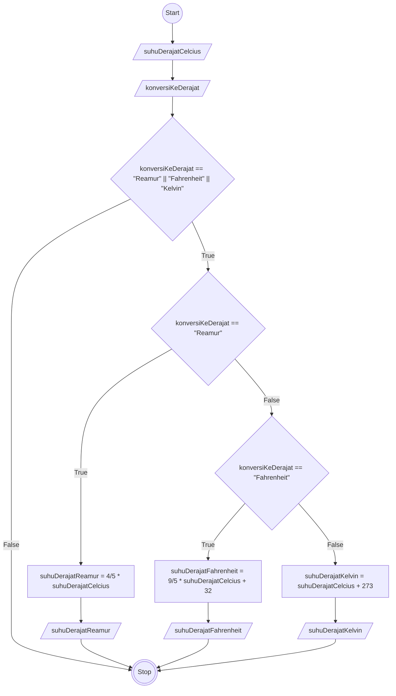

# Algoritma Program Konverter Suhu

## Deskriptif
1. Start
1. Input suhu dalam derajat Celsius
1. Input konversi suhu ke dalam (Reamur, Fahrenheit, Kelvin)
1. Jika nilai input konversi suhu adalah Reamur atau Fahrenheit atau Kelvin maka ke proses selanjutnya. Jika tidak, maka menuju ke stop
1. Jika nilai input konversi suhu adalah Reamur, maka suhu derajat Reamur adalah 4/5 dikali suhu derajat Celcius, lalu output suhu derajat Reamur
1. Jika nilai input konversi suhu adalah Fahrenheit, maka suhu derajat Fahrenheit adalah (9/5 dikali suhu derajat Celcius) ditambah 32, lalu output suhu derajat Fahrenheit
1. Jika nilai input konversi suhu adalah Kelvin, maka suhu derajat Kelvin adalah suhu derajat Celcius ditambah 273, lalu output suhu derajat Kelvin
1. Stop

## Flowchart


## Pseudo-code
```
DECLARE suhuDerajatCelcius: REAL
DECLARE suhuDerajatReamur: REAL
DECLARE suhuDerajatFahrenheit: REAL
DECLARE suhuDerajatKelvin: REAL
DECLARE konversiKeDerajat: STRING

INPUT suhuDerajatCelcius
INPUT konversiKeDerajat

IF konversiKeDerajat = "Reamur" OR konversiKeDerajat = "Fahrenheit" OR konversiKeDerajat = "Kelvin" THEN
    IF konversiKeDerajat = "Reamur" THEN
        suhuDerajatReamur <- 4/5 * suhuDerajatCelcius
        OUTPUT suhuDerajatReamur
    ELSE
        IF konversiKeDerajat = "Fahrenheit" THEN
            suhuDerajatFahrenheit <- 9/5 * (suhuDerajatCelcius + 32)
            OUTPUT suhuDerajatFahrenheit
        ELSE
            suhuDerajatKelvin <- suhuDerajatCelcius + 273
            OUTPUT suhuDerajatKelvin
        ENDIF
    ENDIF
ENDIF
```